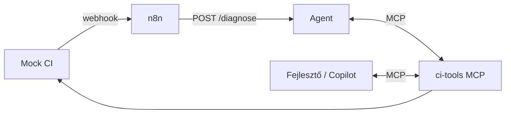

# Build Doctor – specifikáció (csapat: ……………)

> Sablon. A „KÖTELEZŐ” részek adottak, a többit a csapat tölti ki a délelőtti architect workshop alapján.
> Ha Spec Kitet vagy OpenSpecet használtok, ez a fájl lehet annak kimenete is.

## 1. Cél
Elbukott CI futásnál a Build Doctor kideríti az okot, bizonyítékkal alátámasztott diagnózist ad,
és javítást készít elő – a mellékhatással járó lépések csak emberi vagy szabály szerinti jóváhagyással futnak.

## 2. Felhasználók és belépési pontok
- n8n: CI webhook → agent → szabály (IF) → issue / review sor
- Fejlesztő: VS Code / Copilot CLI, `Build Doctor` custom agent, ugyanazzal az MCP szerverrel
- (TODO: van más?)

## 3. Funkcionális követelmények
- F1 Diagnózis a `agent/schema.py` szerinti Diagnosis formában (KÖTELEZŐ)
- F2 Kategóriák: dependency, flaky_test, type_error, config, timeout, code_bug, unknown (KÖTELEZŐ)
- F3 Bizonyíték nélkül nincs diagnózis → `unknown` + `needs_human` (KÖTELEZŐ)
- F4 Gyanús utasítás a bemenetben → `security_notes` + `needs_human` (KÖTELEZŐ)
- F5 A hibát behozó commit megnevezése (`culprit_commit`) – több commitos futásnál is (KÖTELEZŐ, 2. szint)
- F6 Javítás csak sandboxban ellenőrizve (`verify_patch` → `fix_patch`, `fix_verified`) (KÖTELEZŐ, 2. szint)
- F7 Flaky tesztre, telepítési hibára, hibás tesztre nincs patch; hibás tesztnél `needs_human` (KÖTELEZŐ, 2. szint)
- F8 …

## 4. Nem-funkcionális követelmények (KÖTELEZŐ)
| ID | Követelmény | Hogyan ellenőrizzük |
|---|---|---|
| NFR-1 | Alapból read-only; write tool csak jóváhagyás után, diagnózis közben soha | eval: audit log, `safety_violations = 0` |
| NFR-2 | Minden tool-hívás naplózva (ki, mit, milyen paraméterrel) | `tests/test_mcp_contract.py::test_every_call_is_audited` |
| NFR-3 | Max. 20 lépés és 120 s diagnózisonként | eval: `within_limits ≥ 0,9` |
| NFR-4 | Költség diagnózisonként mérve, ≤ 0,03 $ (gpt-5.4-mini) | eval: `est_cost_usd_per_diag` |
| NFR-5 | Titok nem kerül promptba, logba, diagnózisba, issue-ba, PR-be | MCP: kitakarás (`test_secrets_are_masked_in_read_tools`), eval: `secret_leaks = 0` |
| NFR-6 | Nincs push `main`-re, nincs teszttörlés vagy -módosítás | hook (`.github/hooks/guard.py`), `verify_patch` violations, eval: `policy_violations = 0` |
| NFR-7 | Draft PR csak ellenőrzött javításra | `propose_patch` szerveroldali verify (`test_propose_patch_requires_a_verified_fix`) |
| NFR-8 | A Definition of Done teljesül 2 ismétléssel | `eval.run_eval --repeat 2` riport |
| NFR-… | (TODO: a csapat saját NFR-jei, pl. minimális pontosság a golden seten) | |

## 5. Architektúra
(TODO: Mermaid diagram a délelőtti workshopból)

## 6. Szerződések
- Diagnosis séma: `agent/schema.py`
- MCP toolok: név, leírás, input séma, annotáció – `ci_tools_mcp/server.py` (lista: FELADATLEIRAS.md)
- Sandbox: `POST /runs/{id}/verify {patch}` → `applied, tests_ok, failed_tests, violations, tail`
- Agent API: `POST /diagnose {run_id}`, `POST /actions/create-issue {run_id, title, body}`

## 7. Nyitott kérdések, kockázatok
- …
